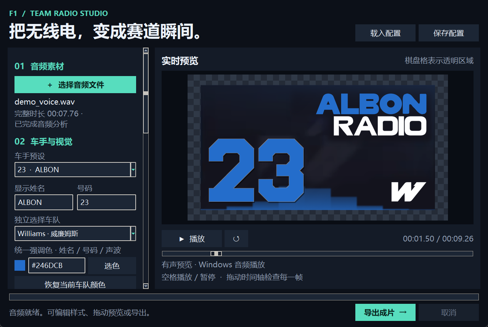
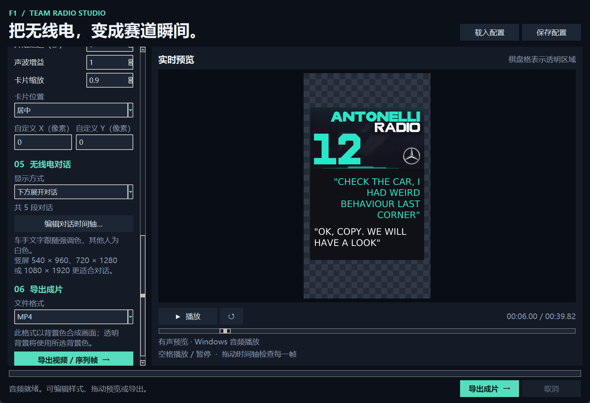

# F1 TEAM RADIO Studio

本地运行的 Python 无线电视频生成程序，带中文桌面界面和命令行入口。选择一段语音、一个车手预设，即可生成带斜向入场、语音驱动九区块波形和淡出效果的 Team Radio 卡片。

## 快速开始

本机已验证 Python 与所需依赖可用，直接双击 [start.bat](start.bat)，或在本文件夹打开终端运行：

~~~powershell
python launch_gui.py
~~~

换到其他电脑时，先安装 **Python 3.10 或更新版本**，安装时勾选 Add Python to PATH，并保留 Tcl/Tk 组件，然后双击 [install.bat](install.bat)。也可以手动安装：

~~~powershell
python -m pip install -r requirements.txt
python -m teamradio doctor
python -m teamradio gui
~~~

运行依赖只有 NumPy、Pillow、imageio-ffmpeg。无需 MoviePy、浏览器、账号或在线服务。imageio-ffmpeg 的标准 Windows 安装包包含 FFmpeg；也支持本机 PATH 中的 FFmpeg，或设置环境变量 FFMPEG_BINARY 指向现有可执行文件。安装完成后，生成与导出均可离线完成。Linux 若未安装 Tk，需要由系统软件包安装 python3-tk；本次实际验证环境为 Windows。

## 桌面操作

1. 点击「选择音频文件」，选择自己的语音。支持 WAV、MP3、M4A、AAC、FLAC、OGG、Opus 等 FFmpeg 能解码的格式，也可以从视频提取第一条音轨。等待完整音频分析完成。
2. 选择车手预设。默认是 **ALBON / 23 / Williams**，与 SAINZ / 55 共用威廉姆斯蓝和白色 W 队标。
3. 按需修改显示姓名、号码，或独立选择车队、彩色/白色徽标、上传自定义图片。修改姓名不会改变队标。只替换徽标时，上传图片即可；切换车队会恢复该车队默认颜色与徽标。
4. 使用唯一的「统一强调色」调整姓名、号码、波形。三者共用同一颜色，不能分别设置。RADIO 保持白色，队标保留自己的颜色，号码的细白边也保持不变。
5. 向下滚动左侧设置区，调整时间、画面、尺寸、位置和导出格式。鼠标停在下拉框或数字框上时，滚轮只滚动设置面板，不会改变选项或数值；请点击选择、手动输入或点击数字框箭头修改。右侧可播放、暂停、重置、拖动时间轴查看实际渲染帧。空格可播放/暂停；光标处于文字输入框时优先输入文字。
6. 点击底部始终可见的「导出成片」，选择保存位置。后台渲染会显示进度，可以取消。失败或取消不会用半成品替换已有目标文件。

Windows 支持系统音频有声预览。其他系统或音频播放不可用时会显示「静音预览」，导出视频仍保留声音。预览画面最多约 30 fps，导出遵循所选帧率。棋盘格只表示透明区域，不会进入成片。

「保存配置 / 载入配置」可以保留样式、动画参数和界面选择的音频路径。JSON 样式配置也可用于命令行；换电脑后需要重新选择当地的音频和自定义队标文件。

## 下方展开对话模式（feature 分支）

新模式参照新增的安东内利、汉密尔顿图片。在「05 无线电对话 → 显示方式」选择「下方展开对话」，点击「编辑对话时间轴…」。也可以先载入 [安东内利示例配置](examples/dialogue_antonelli.json) 或 [完整滚动示例配置](examples/dialogue_scroll.json)。示例配置会从同目录读取演示语音。

1. 每条留言填写开始时间、结束时间、说话人及内容。时间相对于音频开头的 **0 秒**，不包含卡片入场和开场等待。
2. 说话人选「车手」时，文字使用当前统一强调色并靠右；「其他人」包括工程师、车队等所有非车手发言，使用白色并靠左。可以连续或交替添加同类/不同类发言。
3. 一对英文双引号组成一段，例如 "CHECK THE CAR"。粘贴多个完整引号段落时，编辑器会把填写的开始/结束区间等分给各段，再按时间排序；需要精确对齐语音时可以逐段调整。
4. 留言必须按时间排列，结束时间大于开始时间，相邻区间可以首尾相接，但不能重叠。引号外只允许空白；英文双引号必须成对。引号内可手动换行，也会按框宽自动换行。
5. 可以添加、更新、删除段落，导入/导出留言 JSON，或选择某段跳转到预览位置。「保存配置」会同时保存留言和动画设置。文字由用户填写并指定说话人，不会自动转写或自动判断声音身份。

文字框从上往下展开，只展开到当前内容需要的高度。以源卡片宽 **329** 为单位，下方最大高度固定为 **276**，按安东内利图的比例设定；输出尺寸变化时整体等比例缩放。上半部保持原有的卡片、号码、队标、波形和入场动画。

短留言可以累积显示，因此安东内利示例可同时保留一段队色车手文字和一段白色回复。**只有当前视窗剩余空间接不下完整的新引号段落时，才按新段完整可见行数决定停留，再向上滚动到新段顶部的留白起点**；即使新段与上一段属于同一个说话人，也以新的一对引号为单位判断。滚动后，后续能够完整放进当前视窗的段落继续追加，不会每段都重新滚到顶部。超长的一段仍会在段内从头滚到末行，内部滚动同样考虑滚动前停留。展开后的框不自动缩回，直到整个卡片淡出。

编辑器可调整展开时间（默认 0.35 秒）、新段落入位滚动时间（默认 0.45 秒）、「最大停留（秒）」`dialogue_scroll_delay`（默认 **1.0 秒**，范围 **0–10 秒**，设为 0 可取消停留）和字号（默认 26，以源卡片坐标计）。仅在需要滚动时，根据新段在当前滚动位置、面板展开后能够完整显示的非空行数选择等待；被裁切的半行和空行不计入。

| 新段的完整可见行数 | 滚动前停留 |
| --- | --- |
| 0 行 | 立即开始平滑滚动 |
| 1 行 | 最多 0.3 秒，且不超过设定的最大停留 |
| 2 行及以上 | 使用设定的最大停留，默认 1 秒 |
| 整句能完整放下 | 不滚动 |

实际停留不会超过该段的时间区间；之后在 `end` 前完成动画。若区间短于实际停留，则停留到 `end` 并到达最终滚动位置。长段内部滚动也使用这一停留与时间分配规则。等待只由当前新段的可见行数决定，不扣除旧画面已经停留的时间；建议为长留言留足阅读时间。

推荐选择 540×960、720×1280 或 1080×1920 竖屏。对话模式会按「上部卡片 + 下方最大文字区」的完整尺寸适配画布，确保文字不超出画面；同一卡片宽度下，上半部与原模式逐像素一致。关闭对话模式可回到原来只有上半部的展现，已经填写的留言仍会保留。

留言 JSON 最小示例：

~~~json
[
  {"start": 0, "end": 4, "speaker": "driver", "text": "\"CHECK THE CAR\""},
  {"start": 4, "end": 7, "speaker": "other", "text": "\"OK, COPY. WE WILL CHECK.\""}
]
~~~

JSON 字符串中的反斜杠用于保存英文双引号；在编辑器中直接输入普通的英文双引号即可。

~~~powershell
python -m teamradio render --audio "my_radio.wav" --driver antonelli --size 1080x1920 --dialogue "examples/dialogue_messages.json" --output "output/dialogue.mov"
python -m teamradio render --config "examples/dialogue_scroll.json" --audio "examples/dialogue_voice.wav" --output "output/dialogue.mp4"
python -m teamradio preview --config "examples/dialogue_hamilton.json" --time 4 --output "output/hamilton.png"
~~~

使用 --dialogue-expand、--dialogue-scroll、--dialogue-scroll-delay、--dialogue-font-size 可覆盖对应参数，例如 `--dialogue-scroll-delay 1.5` 将最大滚动前停留设为 1.5 秒（新段至少完整可见 2 行时使用）；--no-dialogue 可临时关闭配置中的对话模式。完整配置通过 `dialogue_scroll_delay` 保存停留秒数，旧配置未填写时使用默认 1.0 秒。留言数组也可以嵌在完整配置的 dialogue 字段中，dialogue_enabled 控制是否启用。

[完整对话演示视频](examples/dialogue_demo.mp4) · [短车手留言与白色回复](examples/dialogue_antonelli.png) · [短框示例](examples/dialogue_hamilton.png) · [展开及滚动各阶段](examples/dialogue_stages.png) · [编辑器截图](examples/dialogue_editor_ui.png)

示例音轨 [dialogue_voice.wav](examples/dialogue_voice.wav) 为 Windows Zira 合成语音，演示同样的五段留言，时间取自每段音频的实际长度；不是参考图中的原始车手录音。中文留言优先使用本机中文字体；其他电脑需安装相应中文字体以避免缺字。

## Git 工作方式

工作区已初始化 Git，origin 指向 https://github.com/wertewrt/F1_team_radio。原程序保存在本地 main 基线提交，以上新模式在 feature 分支开发；没有把功能提交合并进本地 main。本次仅配置/读取远端，未自动推送。

~~~powershell
git status
git switch feature
# 需要发布当前分支时自行执行：
git push -u origin feature
~~~

## 视觉与动画

- 根据原始截图重建深色卡片、斜向暗纹、右上角姓名和 RADIO、左下角大号码、右下角车队标识。
- 入场参照提供的录屏：一条约 45° 的亮斜线展开成斜向条带，再展开为完整卡片。默认入场时间 **0.95 秒**，可设为 0 直接出现。
- 退出采用整张卡片透明度线性下降，默认 **0.3 秒**，可自行更改，也可设为 0 直接结束。透明背景下露出下层视频；纯色背景下淡向背景色。
- 全部号码共用同一套按参考结构重建的 **清晰硬边矢量字形**，涵盖 0–9；支持 1–3 位号码。数字 6 保留短顶帽、斜向长笔画及八角下腹。直边与折角经校正，不把截图模糊或像素台阶当作真实轮廓；按目标分辨率直接光栅化，并保留细白边。
- 姓名与 RADIO 使用独立的 **Radio Rounded 矢量字体**，重建原图中更圆润的转播文字轮廓，与硬边号码字体分开。A–Z 及 ALBON 在输出尺寸直接渲染，不放大低分辨率截图；原图只用于校准字形、字宽、字号和位置。特殊字符回退到 DejaVu，Windows 中文优先使用本机微软雅黑；过长姓名会压缩以适配卡片。
- 波形严格为 **9 个从左至右连续排列的柱形区块**，相邻区块没有几何缝隙，横跨完整底边，包含号码与队标下方。区块内部保留轻微细纹和柔和上缘，不再使用 96 根分离竖条。9 个区块同时分析当前约 80 ms 语音的音量与频谱，固定在原位上下律动，不使用从右向左移动的历史音量。起伏集中于中间第 4–6 块，整体升起幅度较上一版提高约 17%；左侧肩部略宽、右侧回落更快，左右高度不做镜像。最外侧保留很小但随声音变化的突起，包含队标下方。中央各块会随语音频谱产生不同高度，快速上升、缓慢回落；真正静音后归零，没有随机动画。增益只改变波形，不改变音轨音量。
- 号码与姓名采用重建字体，入场采用重建几何动画；它们是对素材风格的复现，并非原版转播工程或原版专有字体。原截图和徽标素材不会被覆盖。

## 时间参数

| 参数 | 默认值 | 含义 |
|---|---:|---|
| start_delay | 0 秒 | 成片开始后等待多久才出现卡片 |
| entrance | 0.95 秒 | 斜向展开时间；结束后开始播放语音 |
| hold | 0.25 秒 | 语音结束后，卡片继续停留多久 |
| fade_out | 0.3 秒 | 停留结束后的淡出时间 |
| dialogue_scroll_delay | 1.0 秒 | 对话滚动前停留，范围 0–10 秒；短区间保留停留至该段 end，滚动动画在剩余时间内压缩 |
| gain | 1.0 | 波形灵敏度，不调整导出声音 |

**总时长 = 开场等待 + 入场 + 内容时长 + 结束停留 + 淡出。** 原模式的内容时长等于完整语音时长；对话模式取「语音时长」与「最后一段留言结束时间」中的较大值。 语音从 start_delay + entrance 时刻开始播放，没有截去开头，也不会变速。视频帧按所选 FPS 对齐，成片时长最多存在约一帧的取整差异；音频分析时间精度为 1/16000 秒。语音停止后，波形停止，卡片按停留和淡出参数结束。

程序没有人为设置语音时长上限。音频与波形特征使用磁盘临时文件和内存映射，逐帧渲染，不会把整段视频帧存入内存。实际可处理时长取决于剩余磁盘、目标格式及电脑性能；30 fps 分析缓存约 **234 MB/小时**，桌面试听还需额外 WAV 空间，GIF 使用额外临时视频。非常长的音频建议使用命令行导出以节省试听缓存。普通 RIFF WAV 的有声试听有文件大小限制，超大文件可能回退为静音预览；这不限制完整音轨导出。

## 导出格式

| 格式 | 视频与音频 | 透明背景 | 用途与限制 |
|---|---|---|---|
| MP4 | H.264 + AAC | 否 | 通用成片；透明区域自动铺背景色 |
| MOV | ProRes 4444 + PCM 16-bit | 支持平滑 Alpha | 推荐导入剪辑软件叠加；文件较大 |
| WebM | VP9 + Opus | 支持平滑 Alpha | 体积较小，需播放器/剪辑器支持 VP9 Alpha |
| MKV | H.264 + AAC | 否 | 通用容器；铺背景色 |
| AVI | MPEG-4 + PCM 16-bit | 否 | 兼容用途；铺背景色 |
| GIF | 调色板动画，无音轨 | 仅二值透明 | 最多 256 色，透明边缘和淡出不能保持平滑，时间精度为百分之一秒 |
| ZIP | RGBA PNG 序列 + WAV + JSON | 支持平滑 Alpha | 高质量逐帧交换，按 metadata.json 中 FPS 导入 |

ZIP 中包含 frames/00000000.png 起的完整画面、soundtrack.wav 和 metadata.json。WAV 已加入开头等待与入场静音，并补齐结尾，在剪辑时间线 **0 秒** 对齐，不要再重复加延迟。音频从原文件单独读取；分析用的 16 kHz 单声道副本不会替换成片音轨。AAC/Opus 等采用对应编码器重编码；PCM 导出为 16-bit，并保留源音频采样率与声道数。

普通播放器可能把透明 MOV/WebM 显示为黑色背景，这不代表文件失去透明通道。若要用于剪映、Premiere、Resolve 等，优先尝试 MOV；具体兼容性取决于软件版本。需要稳定逐帧 Alpha 时使用 ZIP PNG 序列。对 GIF 想保留可见的平滑变暗效果时请选择纯色背景。

画面预设支持 960×540、1920×1080、3840×2160 和竖屏 540×960、720×1280、1080×1920；桌面帧率支持 20、24、25、30、50、60。卡片按原图实测保持 **329:176** 的比例；输出视频仍可选 16:9 或竖屏，卡片不会被拉伸。卡片比例 0.1–1、居中/四角/自定义像素位置可调。自定义位置超出画布的部分会裁切。

## 车队与车手预设

预设以本工作区截图中的姓名、号码、配色和队标为准，并非联网查询的实时赛季名单。保留截图里的额外车手 TSUNODA，同时补上 ALBON，共 **23 个车手、11 支车队**。

| 车队键 | 统一代表色 | 默认队标 | 车手与号码 |
|---|---|---|---|
| mercedes | #26E7C8 | 白色 | RUSSELL 63、ANTONELLI 12 |
| ferrari | #ED123F | 彩色 | LECLERC 16、HAMILTON 44 |
| mclaren | #FF8A00 | 白色 | NORRIS 1、PIASTRI 81 |
| red_bull | #3876CD | 彩色 | VERSTAPPEN 3、HADJAR 6 |
| racing_bulls | #80A2FF | 白色 | LAWSON 30、LINDBLAD 41、TSUNODA 22 |
| alpine | #00A7DF | 白色 | GASLY 10、COLAPINTO 43 |
| haas | #E8E9EB | 彩色 | OCON 31、BEARMAN 87 |
| audi | #FF3C14 | 白色 | HULKENBERG 27、BORTOLETO 5 |
| williams | #246DCB | 白色 | ALBON 23、SAINZ 55 |
| aston_martin | #239D7D | 白色 | ALONSO 14、STROLL 18 |
| cadillac | #B8BAC0 | 白色 | PEREZ 11、BOTTAS 77 |

每队都内置彩色、白色两版徽标。截图存在游戏画面、压缩和屏摄偏色，上表颜色是据素材选择的模板值；可以使用统一色选项自行校准。徽标从图集中提取，源图约 150px 宽，放大到 4K 时清晰度受源素材限制，可上传更高清的透明 PNG/WebP 替换。

[原图与修正版对照](examples/reference_comparison.png) · [高清阿尔本预览](examples/albon_preview.png) · [全部车手预览](examples/all_presets.jpg) · [入场/淡出阶段](examples/animation_stages.jpg)

对照图左列为原始截图，右列为按目标分辨率渲染的重建结果。比对使用冻结的近似波形高度来观察布局；参考图对应的原始语音未提供，不能反推当时的精确波形。源图中永久被文字遮挡的底纹需要推测补全；转播专有原版字体文件未提供，因此本程序重建可见字形结构，不声称逐像素恢复原始制作工程。

## 命令行

查看完整选项和环境：

~~~powershell
python -m teamradio render --help
python -m teamradio presets
python -m teamradio doctor
~~~

最常用的阿尔本成片：

~~~powershell
python -m teamradio render --audio "我的语音.wav" --driver albon --output "output/albon.mp4"
~~~

1080p、60 fps、0.5 秒淡出、透明剪辑素材：

~~~powershell
python -m teamradio render --audio "radio.mp3" --driver sainz --size 1920x1080 --fps 60 --fade-out 0.5 --background transparent --output "output/sainz.mov"
~~~

单独改姓名和队标，同时设定统一颜色：

~~~powershell
python -m teamradio render --audio "radio.wav" --driver albon --name "MY DRIVER" --number 23 --logo "my_logo.png" --color "#246DCB" --output "output/custom.webm"
~~~

只生成一张预览图；加 --audio 可以使用真实语音波形，不加时使用说明用的演示曲线：

~~~powershell
python -m teamradio preview --driver albon --audio "examples/demo_voice.wav" --time 1.2 --output "output/preview.png"
~~~

保存配置、再次复用：

~~~powershell
python -m teamradio render --audio "radio.wav" --driver albon --output "output/first.mp4" --save-config "my_style.json"
python -m teamradio render --config "my_style.json" --audio "another.wav" --output "output/second.mov"
~~~

显式命令行选项覆盖 JSON 中的同名选项。配置中的相对 logo_path 以配置所在文件夹为基准。已有输出默认拒绝覆盖，确需替换时使用 --overwrite；Ctrl+C 可中断。导出到 resource、assets 或程序包文件夹，以及覆盖输入音频/自定义队标的操作会被拒绝。

## 文件与示例

- [launch_gui.py](launch_gui.py)：桌面程序入口。
- [teamradio/renderer.py](teamradio/renderer.py)：原图比例卡片、高清硬边号码、圆润矢量文字、统一配色与九区块动画。
- [assets/numerals/contours.json](assets/numerals/contours.json)：可按任意输出分辨率渲染的统一号码多边形。
- [assets/fonts/RadioRounded-Bold.ttf](assets/fonts/RadioRounded-Bold.ttf)：重建的圆润姓名字库；RADIO 使用同目录独立字重。
- [teamradio/media.py](teamradio/media.py)：音频分析、音画同步和七种格式导出。
- [teamradio/presets.py](teamradio/presets.py)：全部车队/车手模板，可按需要扩展。
- [assets/ASSET_NOTES.md](assets/ASSET_NOTES.md)：徽标和字体来源说明。
- [examples/albon_demo.mp4](examples/albon_demo.mp4)：带演示语音的阿尔本成片。
- [examples/centered_wave_demo.mp4](examples/centered_wave_demo.mp4)：当前中心聚集、两端低起伏、无横向滚动的动态示例。
- [examples/wave_motion_check.png](examples/wave_motion_check.png)：同一段语音在不同时刻的波形分布检查。
- [examples/albon_alpha.webm](examples/albon_alpha.webm)：带透明背景的对应短片。
- [examples/demo_voice.wav](examples/demo_voice.wav)：本机 Windows Zira 合成的演示语音，不是阿尔本本人录音。
- [examples/albon.json](examples/albon.json)：示例样式配置。
- [examples/russell_preview.png](examples/russell_preview.png)：1080p 的 63 号锐利字形示例。
- [examples/russell_4k.png](examples/russell_4k.png)：3840×2160 原尺寸渲染，用于检查数字和文字的真实清晰度。
- [examples/reference_comparison.png](examples/reference_comparison.png)：原图和高清矢量重建的并排对照。

示例语音内容为 Box this lap, Alex. Great job. Keep pushing. We are looking good. 原有 resource 文件夹完整保留，程序日常运行使用已经提取好的 assets 素材，无需每次重新处理截图。

## 验证与排错

~~~powershell
python -m teamradio doctor
python -m unittest discover -s tests -v
~~~

开发用的字形提取/重建工具与原图字形审核测试需要额外依赖，可运行 python -m pip install -r requirements-dev.txt 安装；普通生成视频只需要 requirements.txt 中的三个依赖。

测试涵盖真实 FFmpeg 的全部格式生成与解码、MOV/WebM/PNG 的 Alpha、静音与音量响应、完整语音与延迟、原声道 PCM 同步、号码白边、统一颜色、斜向入场、指定时间淡出、异常与取消时的文件清理。桌面界面还执行了实际 Tk 生命周期、有声预览准备、导出、取消、关闭、高 DPI 适配和配置往返检查。

- 启动提示 ModuleNotFoundError：使用启动程序的同一个 Python 执行 python -m pip install -r requirements.txt。
- 找不到 FFmpeg：重新安装 imageio-ffmpeg，或设置 FFMPEG_BINARY。doctor 会核对所需编码器。
- 波形太弱或太高：调整增益；增益不改变声音。如果输入音频本身静音，波形不应跳动。
- 长片导出失败：检查系统临时盘与输出盘剩余空间；MOV、PNG 序列和 GIF 临时文件可能很大。关闭占用目标文件的播放器再重试。
- 自定义队标出现方形底：上传带真实 Alpha 的 PNG/WebP；普通 JPG 本身没有透明通道。
- 编码器不支持：使用 imageio-ffmpeg 随包的标准 FFmpeg，或更换包含对应编码器的版本。
